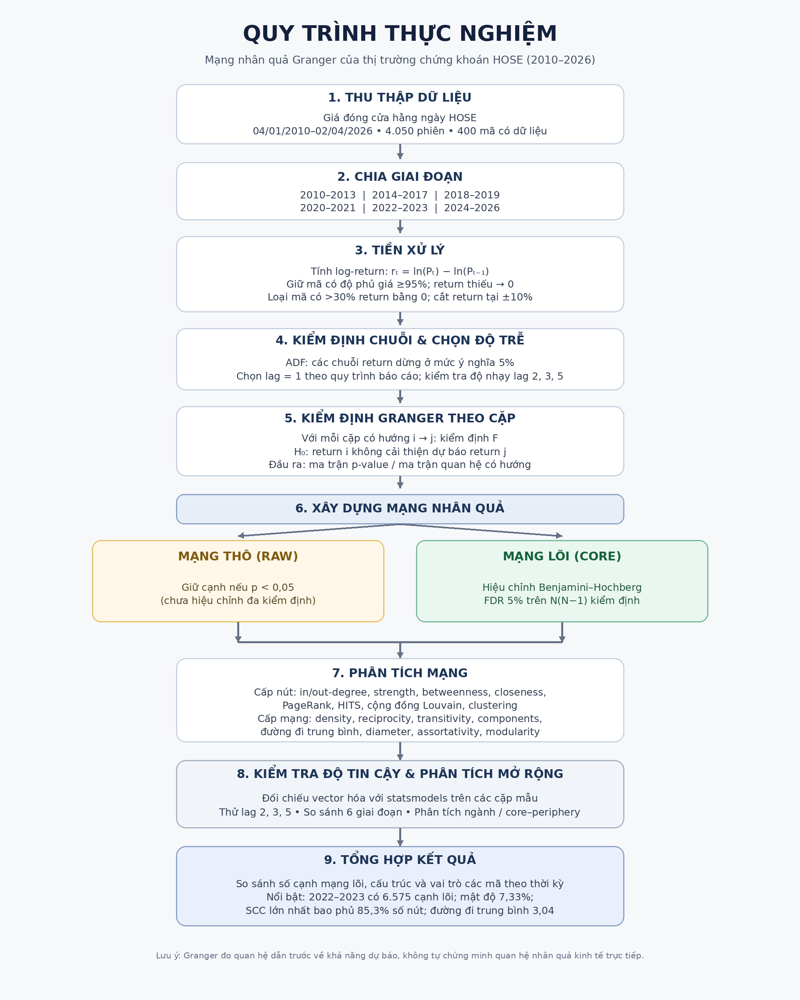

# Mạng Granger thị trường chứng khoán HOSE

Pipeline xây dựng mạng nhân quả Granger (directed network) giữa các cổ phiếu HOSE theo từng giai đoạn, tính in-degree, out-degree và các chỉ số mạng liên quan.

## Cấu trúc

```
hose_network/
├── run_pipeline.py        điểm vào (CLI): Granger và mạng
├── run_centrality.py      điểm vào (CLI): trung tâm, ngoại vi, ngành, danh mục
├── requirements.txt
├── data/
│   ├── hose_stock_data.csv    giá đóng cửa dạng wide (datetime + mã cổ phiếu)
│   └── sector_map.csv         phân ngành 403 mã (tự lập, có cột độ tin cậy)
├── src/
│   ├── config.py          giai đoạn mặc định và tham số
│   ├── data_loader.py     đọc dữ liệu, lọc, log-return, kiểm định ADF
│   ├── granger.py         Granger pairwise vectorized, chọn lag, hiệu chỉnh FDR
│   ├── network.py         dựng đồ thị, chỉ số node và chỉ số toàn mạng
│   ├── sensitivity.py     độ nhạy theo số lag
│   ├── centrality.py      thước đo trung tâm, ngoại vi và chỉ số hỗn hợp X, Y (Pozzi 2013)
│   ├── sectors.py         phân tích theo ngành: dẫn dắt, dòng chảy, đồng ngành
│   ├── portfolio.py       kiểm định danh mục lõi so với ngoại vi, độ bền vững
│   ├── centrality_pipeline.py  điều phối phần mở rộng
│   ├── validation.py      đối chiếu p-value với statsmodels
│   ├── visualization.py   biểu đồ
│   └── pipeline.py        điều phối toàn bộ quy trình
└── outputs/               kết quả đã chạy sẵn
```

## Chạy

```
pip install -r requirements.txt
python run_pipeline.py
python run_pipeline.py --start 2022-01-01 --end 2023-12-31 --name P5 --lag 2
```

Tham số: `--lag`, `--max-lag`, `--alpha`, `--min-coverage`, `--max-zero-share`, `--seed`, `--data`, `--output`.

## Quy trình


## Đầu ra

`outputs/<giai đoạn>/` gồm `context.json`, `granger_F_matrix.csv`, `granger_p_matrix.csv`, và thư mục `raw05/`, `fdr05/` với `node_metrics.csv`, `edges.csv`, `adjacency_matrix.csv`, `network.graphml` (mở bằng Gephi), `summary.json`, `figures/`.

Tổng hợp: `period_comparison_*.csv/png`, `node_metrics_all_periods_*.csv`, `leader_persistence_*.csv/png`, `sensitivity_lag.csv`, `run_summary.json`.

## Phần mở rộng: trung tâm, ngoại vi, chỉ số Pozzi và ngành

```
python run_pipeline.py
python run_centrality.py
```

`run_centrality.py` đọc ma trận F và ma trận kề đã lưu trong `outputs/<giai đoạn>/`, chiếu mạng có hướng thành đồ thị vô hướng (trọng số = tổng F, khoảng cách = 1/F), giữ thành phần liên thông lớn nhất và tính: bậc, cường độ, betweenness, eigenvector (u và w), eccentricity, closeness (đường đi ngắn nhất trung bình, u và w), rồi X, Y theo Pozzi (2013) và Z = (X+Y)/2 (thấp = trung tâm).

Lưu ý: `data/sector_map.csv` do người lập tự phân loại theo hoạt động kinh doanh (xấp xỉ ICB), cột `confidence` đánh dấu mức tin cậy. Nên đối chiếu với nguồn chính thức trước khi dùng cho kết luận quan trọng.

Đầu ra trong `outputs/centrality/`: `<rule>/<giai đoạn>_centrality.csv`, `top_central_stocks.csv`, `sector_lead_follow.csv`, `sector_overrepresentation_top_central.csv`, `sector_homophily.csv`, `portfolio_core_vs_periphery.csv`, `centrality_persistence.csv`, `z_vs_next_period_traits.csv`, `<rule>/figures/`.
